# Визуальная галерея IMPULSE — 12 SVG

Все изображения ниже — **самостоятельные векторные схемы** 1600×900 для разработки и визуального разбора. Это **не** исходные Apple Design Resources, **не** скриншоты Apple и **не** pixel-perfect подтверждение. Для оригиналов используйте [официальную страницу Apple Design Resources](https://developer.apple.com/design/resources/), соблюдая лицензию.

Откройте [HTML-галерею](visual-gallery.html) для удобного просмотра либо выберите SVG прямо ниже.

| | |
|---|---|
| **01 · [Навигация](01-navigation/README.md)** <a href="01-navigation/reference-board.svg">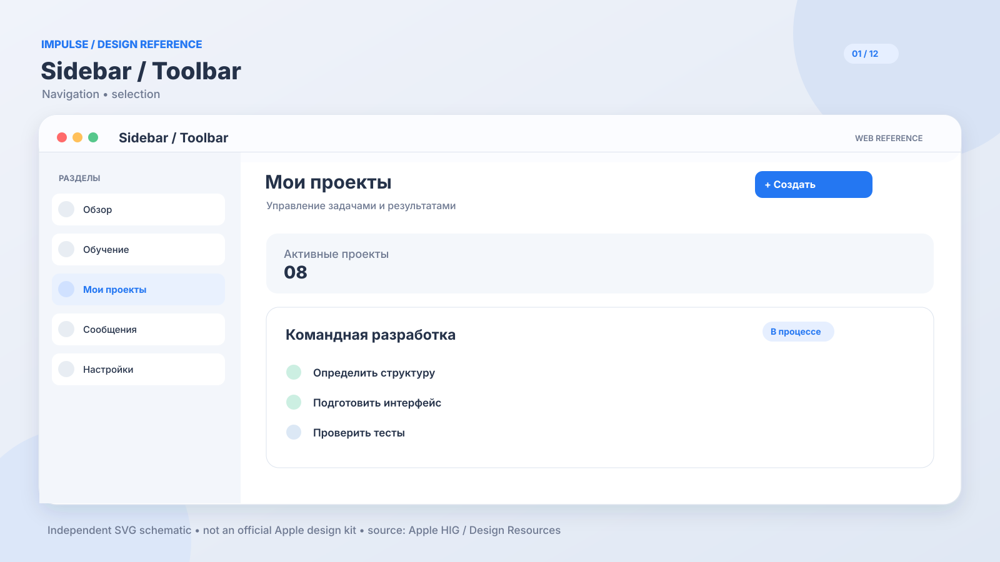</a> | **02 · [Liquid Glass](02-liquid-glass/README.md)** <a href="02-liquid-glass/reference-board.svg">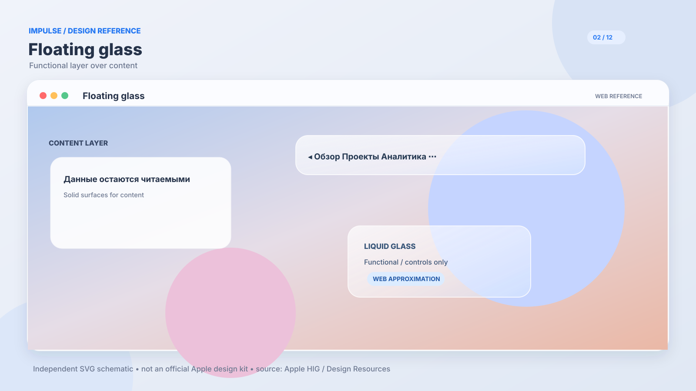</a> |
| **03 · [Сообщения](03-messaging/README.md)** <a href="03-messaging/reference-board.svg">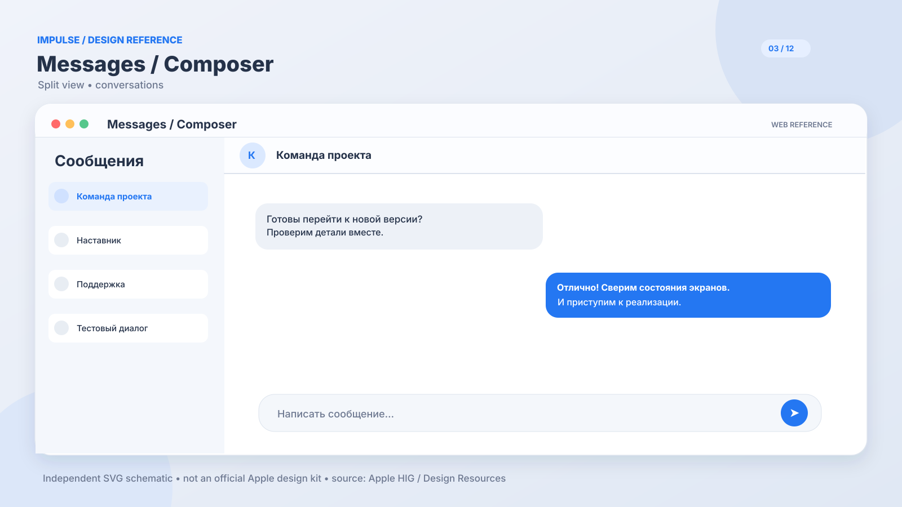</a> | **04 · [Кнопки и формы](04-inputs-and-controls/README.md)** <a href="04-inputs-and-controls/reference-board.svg">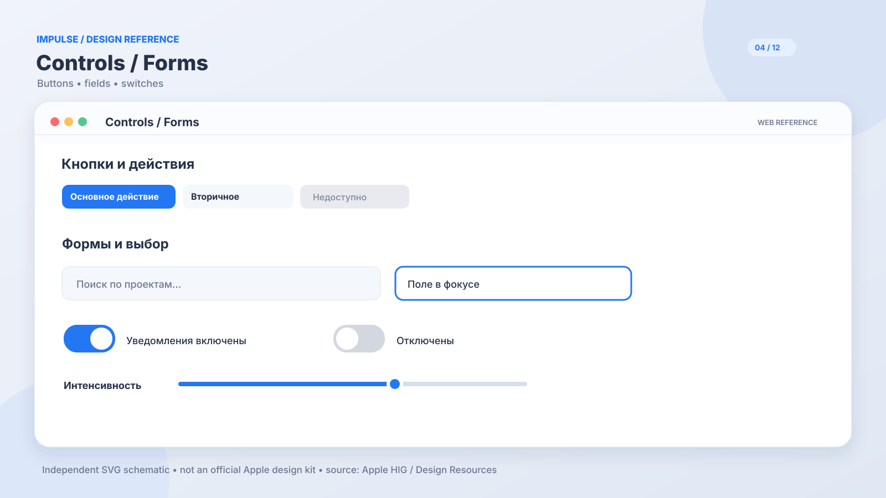</a> |
| **05 · [Диалоги и меню](05-overlays-and-dialogs/README.md)** <a href="05-overlays-and-dialogs/reference-board.svg">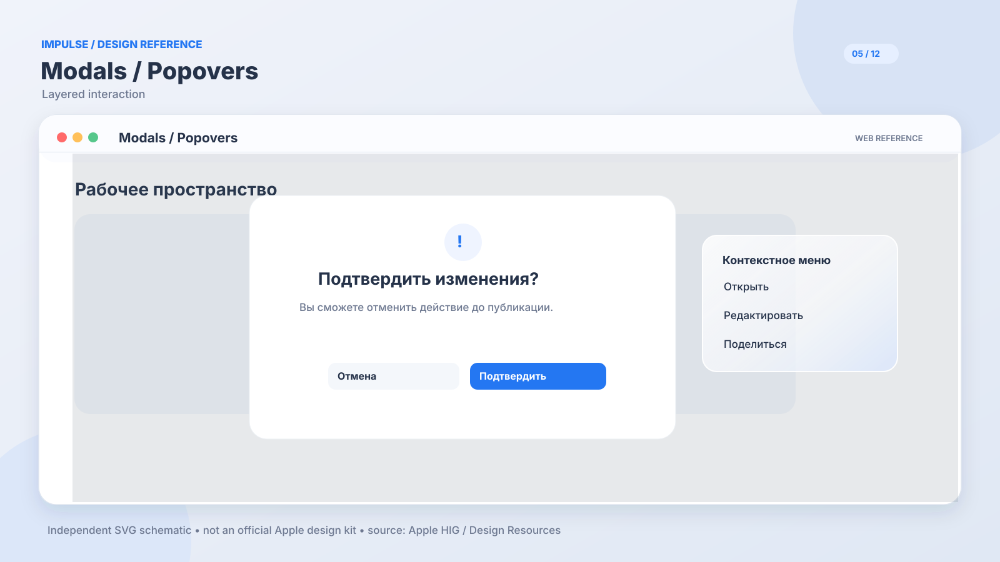</a> | **06 · [Данные и аналитика](06-data-and-dashboards/README.md)** <a href="06-data-and-dashboards/reference-board.svg">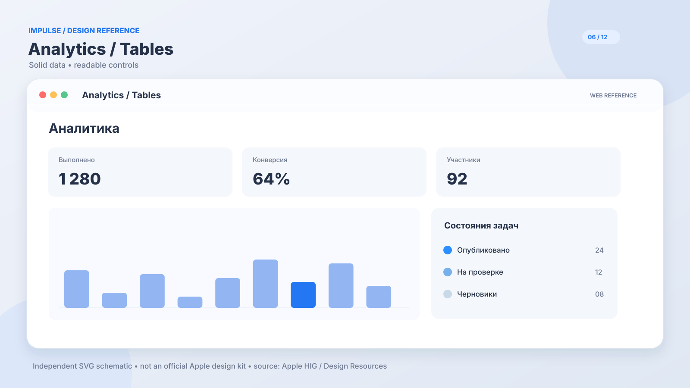</a> |
| **07 · [Адаптивность](07-mobile-adaptive/README.md)** <a href="07-mobile-adaptive/reference-board.svg">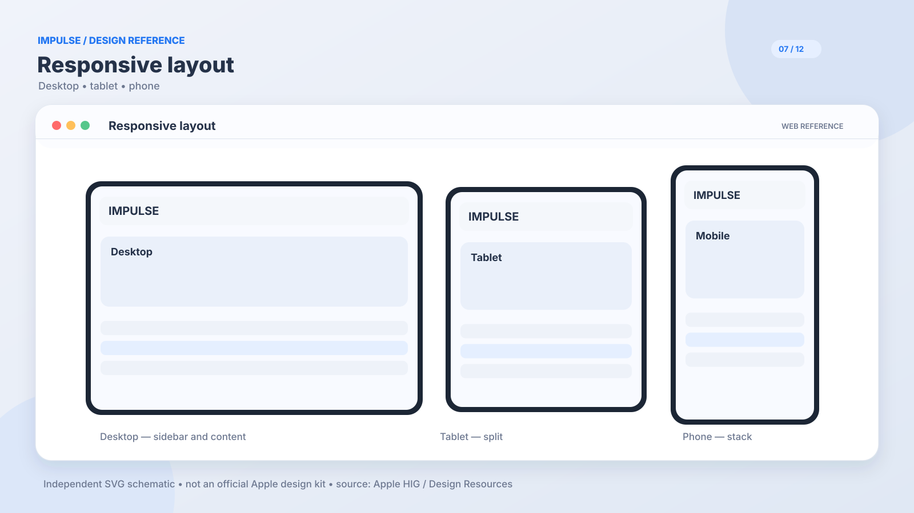</a> | **08 · [Доступность](08-accessibility/README.md)** <a href="08-accessibility/reference-board.svg">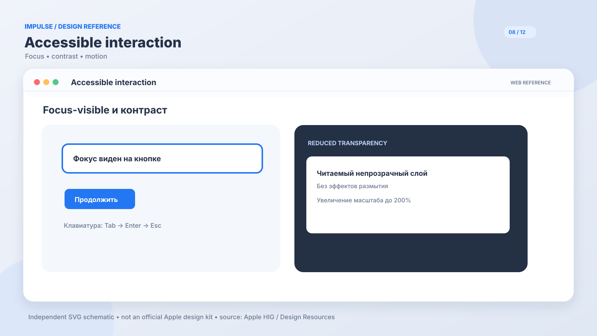</a> |
| **09 · [Поиск](09-search-and-command/README.md)** <a href="09-search-and-command/reference-board.svg">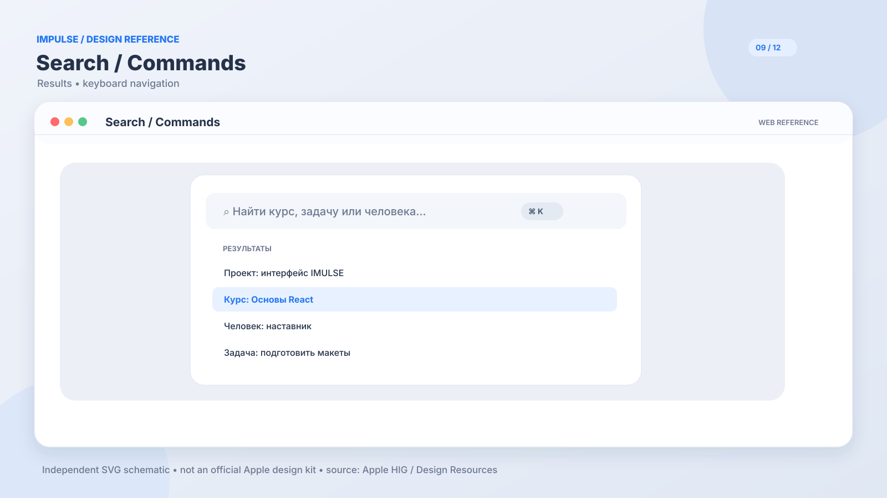</a> | **10 · [Уведомления](10-notifications-and-feedback/README.md)** <a href="10-notifications-and-feedback/reference-board.svg">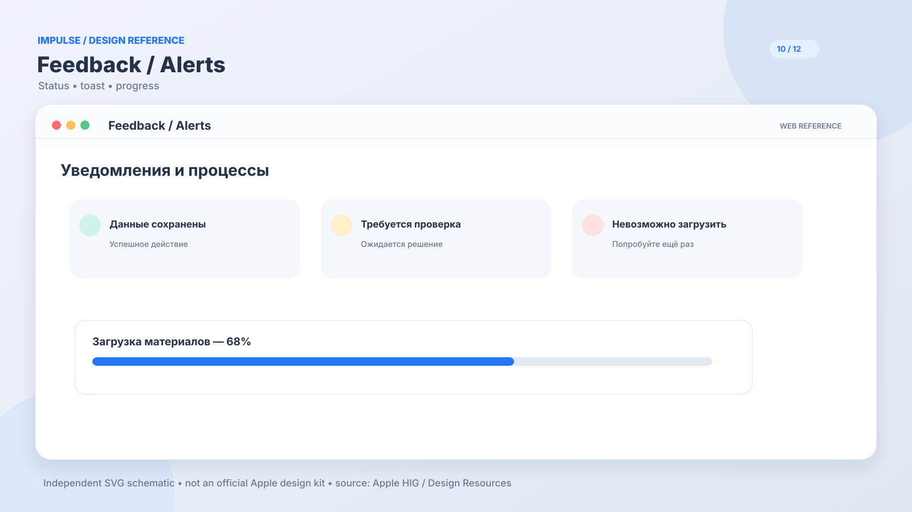</a> |
| **11 · [Настройки](11-identity-and-settings/README.md)** <a href="11-identity-and-settings/reference-board.svg">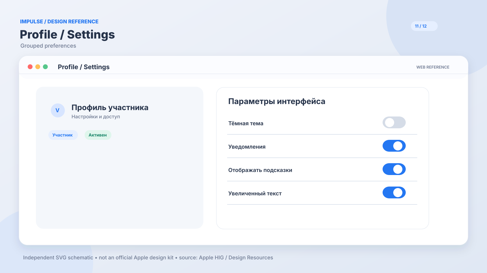</a> | **12 · [Вложения](12-media-and-attachments/README.md)** <a href="12-media-and-attachments/reference-board.svg">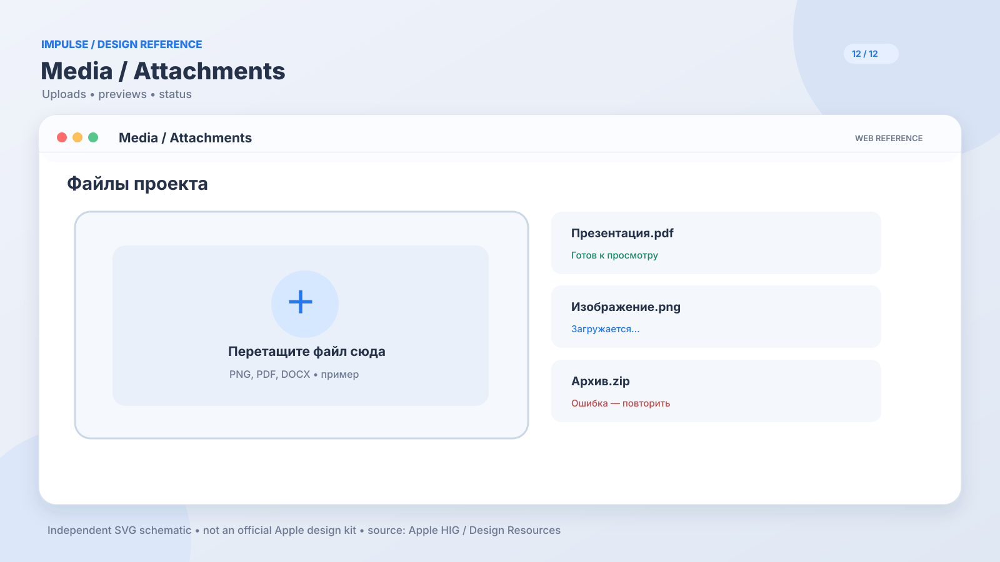</a> |

## О качестве и происхождении

Каждое изображение основано на **общих принципах Apple HIG** и нарисовано самостоятельно для IMPULSE. Укажите конкретный вариант официального Figma/Sketch компонента, его разрешение, состояние и измеренные размеры отдельно перед заявлением о точности 1:1. Подробности: [манифест SVG](visual-manifest.json), [спецификация компонентов](../02-specifications/component-catalog.md), [визуальный QA](../03-impulse/visual-qa-checklist.md).
