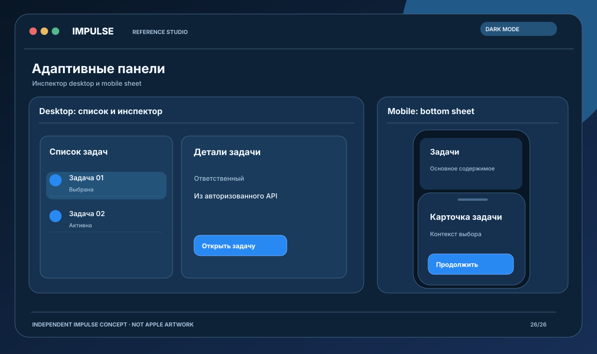
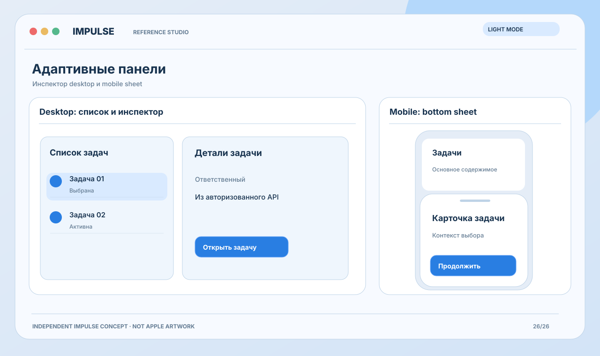

# 26. Адаптивные панели

**Официальный Apple-источник:** [HIG: popovers](https://developer.apple.com/design/human-interface-guidelines/popovers); [UI Kits 27 в Figma и Sketch](https://developer.apple.com/design/resources/).

## Использование в Impulse

- Сценарий: Инспектор desktop и mobile sheet.
- Критическое условие: Закрытие, восстановление фокуса, safe area.
- Проверять default, active, focus, disabled, loading, error, selected, mobile, light/dark, reduced transparency/motion, keyboard и aria, где применимо.
- Сохранять настоящий API/RBAC и все существующие действия, не копировать демонстрационные данные из иллюстрации.

## Pixel parity gate

Это два оригинальных **концептуальных SVG**, не официальные Apple-картинки и не точный порт Figma/Sketch. Требуется открыть соответствующий versioned official design frame, измерить компоненты и их состояния, проверить лицензии, затем сравнить с приложением на 1422×803, 1440×900, 1024×768, 390×844, 320px с фиксированным DPR и реальными шрифтами; принять только после overlay/diff и проверки поведения.
