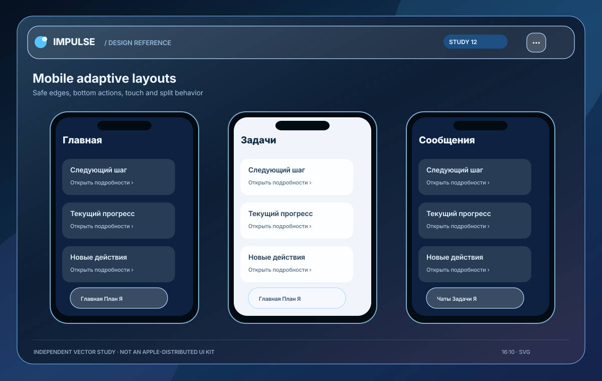

# 12 · Mobile adaptive layouts

**Purpose:** Safe edges, bottom actions, touch and split behavior.

**Source authority:** [Apple Design Resources — iOS/iPadOS 27 and macOS 27 kits](https://developer.apple.com/design/resources/); [Apple HIG — Designing for iOS](https://developer.apple.com/design/human-interface-guidelines/designing-for-ios). Read the actual Figma/Sketch layers and their license before claiming visual equivalence.

## Case states and visual decisions

- **Study content:** Compact list, bottom tabs, chat, detail.
- **Impulse rule:** Use owner-approved responsive navigation, touch 44px target.
- **Potential integration touchpoint:** `frontend/src/app/impulse-next.scss` (study only; do not modify from this directory).
- **UI states to collect from original kit:** default, hover/pressed where relevant, focus, selected, disabled, loading/error/empty when applicable, compact/expanded, light/dark, high contrast.
- **Layout checkpoints:** desktop 1440×900 and 1422×803; tablet 1024×768; mobile 390×844 and 320px. Measure against the original frame at the same density before any *1:1* statement.
- **Quality gate:** preserve keyboard focus, real handlers, RBAC, source-backed data, WCAG contrast, reduced motion/transparency, and responsive touch targets. Do not replace native behavior with screenshot-like inert HTML.

## Provenance and acceptance

`cover.svg` is an **original vector concept study for Impulse**, not Apple artwork, not captured from the Apple 27 kits, and **not a pixel-verified Apple component**. It is intentionally editable and scalable; do not extract numeric design tokens from its illustrative proportions as if measured from Apple. Official reference is kept as an external link; proprietary templates, SF Symbols and font binaries are not redistributed. See [kit license guidelines](../../PROVENANCE_AND_LICENSE.md) and [pixel comparison protocol](../../PIXEL_PARITY_QA.md).

**Status:** conceptual visualization done; official editable kit measurement and screenshot-diff acceptance pending.
