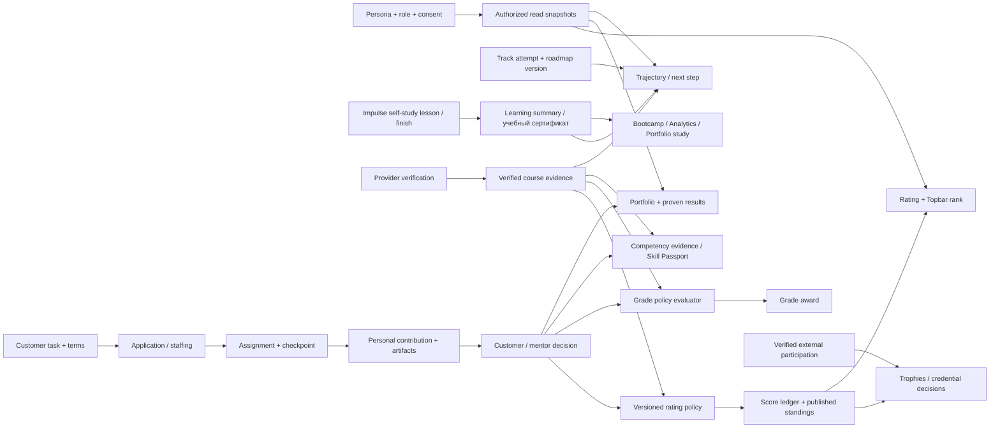

# Domain/entity relationship matrix — Impulse (code inspection, 26 October 2026)

This inventory lists **actual SQLAlchemy `domain_table` definitions** in `src/impulse/infrastructure/models/*.py`; it is not a database migration or a claim that all corresponding screens are already wired correctly.

## 1. Source-of-truth inventory

| Context | Persisted tables | Facts / owner |
| --- | --- | --- |
| Identity | `persons`, `actor_roles`, `sessions`, `consents`, `visibility_settings`, `profile_skills` | Кто пользователь, какие роли, что он разрешает показывать. До применения RBAC любой агрегат остаётся закрытым |
| Development | `tracks`, `track_attempts`, `roadmap_versions`, `milestones` | Роль, активность трека, roadmap version, подтверждённое завершение этапа |
| Provider learning | `courses`, `course_track_links`, `enrollments` | Каталог, связь курса с ролью, reported/verified/rejected/revoked enrollment |
| Engagement | `learning_days`, `qualification_events`, `freeze_days`, `freeze_exceptions`, `weekly_rhythm_versions` | Qualified learning day, streak, freezes and selected weekly rhythm |
| Goal | `monthly_goal_plans` | Цель пользователя, версия и milestones, без выдачи нового подтверждения |
| Work catalog | `projects`, `tasks`, `task_terms_versions`, `task_bookmarks`, `task_invitations` | Заказчик создаёт проект/задачу/версии условий и приглашения; bookmark не = участие |
| Staffing | `applications`, `team_request_versions`, `candidate_reservations`, `assignments` | Отклик, приглашение, отбор/резерв и подтверждённое назначение |
| Execution | `deadline_requests`, `contributions`, `artifacts`, `acceptances`, `appeals` | Личный вклад, файлы, версии, решение приёмки, спор |
| Mentor/reward | `review_rubrics`, `review_5plus_versions`, `compensation_terms`, `payout_claims`, `settlement_attempts` | Review evidence, оценка, условия и финансовые события; не предполагать оплату из статуса задания |
| Recognition | `seasons`, `rating_policies`, `score_ledger`, `standings`, `credentials`, `trophies`, `offer_evidence` | Policy, баллы с источниками, опубликованный рейтинг, подтверждённые награды/выданные credentials |
| Competencies | `competency_models`, `competency_definitions`, `competency_evidence` | Модель компетенций и уровней; доказательства с source IDs |
| Ecosystem | `external_sources`, `programs`, `events`, `participation_claims`, `provider_records` | Мероприятия, участие и статус external verification |
| Collaboration | `messaging_channels`, `messaging_memberships`, `messaging_messages`, `messaging_read_cursors` | Чаты, состав, сообщения, прочтения; не начисляют XP |
| Notifications | `notifications` | Напоминания и уведомления; не первичный факт подтверждения |
| AI Buddy | `buddy_threads`, `buddy_messages`, `buddy_feedback`, `buddy_memory_suppression`, `buddy_suggestion_states`, `buddy_deletion_audits` | Диалог и согласия агента; агент объясняет authorized state, не меняет его без domain command |
| Talent pipeline | `talent_pipeline_events` | HR pipeline status, никак не замещает accepted project result |
| Operations | `operations_cases`, `case_decisions` | Approval/discipline/moderation audit, reviewer actor and decision |

**Gap requiring verification:** сохранение Impulse self-study `lesson/finish/practice` необходимо проверить отдельно через его runtime store и API; оно не равнозначно `enrollments` provider learning. Нельзя считать два источника одной таблицей или выполнять неявное присвоение курса.

## 2. Directed domain dependencies

Edges describe *eligibility or read dependencies*, not unconditional auto-awards. In particular course finish → grade and lesson finish → rating edges **do not exist**.

## 3. Cross-role mutation/reaction matrix

| Originating actor, domain command | Participant refresh | Other authorized users |
| --- | --- | --- |
| Participant: lesson/checkpoint/finish, practice submitted | Bootcamp progress, activity, trajectory study status, portfolio study, certificates; provider-verified fields unchanged | Mentor may see only permitted training progress |
| Provider/operator: course verified/revoked | Roadmap verified markers, grade **eligibility**, talent passport, portfolio, analytics, issued certificate status | HR/mentor only with consent + active access |
| Participant: task application/withdraw | Catalog state, participant applications, “Мои задачи” | Customer applicants/places; no project membership before accepted |
| Customer: accepts application | “Мои проекты”, team, task progress, next action, analytics | Customer staffing/analytics, mentor/project team |
| Participant: checkpoint/files/contribution submission | Task workspace, review state, activity | Customer/mentor review queue, project events |
| Customer/mentor: contribution accepted/rework/revoke | Project result, portfolio, skill evidence, rating eligibility, task completion | Customer analytics, responsible mentor |
| Operator: rating score/correction/publication | Topbar ranking, rating page, eligible achievements | Public only for published non-hidden cohort |
| Operator: recognition event/certificate revocation | Portfolio, awards, verification links, analytics | Public verifiers according to status + consent |
| Participant: preference/consent/profile change | Private profile, public controls, search visibility, authorized reads | HR, mentor, customer, Buddy must not expose stale data |
| Participant: chat message/read cursor | Messaging/unread only | Authorized channel members only |

## 4. Refresh keys confirmed by direct UI reads
- `["impulse-study", courseKey]`, `["impulse-learning-summary"]`, `["bootcamp-v2-overview", track]`, `["bootcamp-v2-detail", courseKey, snapshot]`
- `["development-overview"]`, `["trajectory-roadmaps"]`, `["trajectory-roadmap-catalog"]`, `["trajectory-map"]`, `["trajectory-map-detail", key]`
- `["participant-growth-analytics"]`, `["participant-analytics"]`, `["engagement-overview"]`, `["engagement-freeze"]`, `["engagement-rhythm"]`
- `["portfolio"]`, `["talent-passport"]`, `["project-credentials"]`, `["my-work"]`, `["workspace-task-detail", taskId]`
- `["task-catalog-v2"]`, `["task-catalog-v2-detail"]`, `["customer-activity-events"]`, `["customer-tasks"]`
- `["rating-seasons"]`, `["rating-season-leaderboard", seasonId]`, `["event-claims"]`, `["ecosystem-events"]`

Some consumer keys may be hidden behind helper functions, require read-only source review and new tests before XS-102 can be accepted as complete.

## 5. Integrity and permission invariants
1. Data for `person_A` never leaks to `person_B` via cache, public profile, HR feed or Buddy. An auth change flushes private query cache and in-flight state.
2. Course `finished=true` is not `EnrollmentStatus.VERIFIED`. A learning course completion produces an educational outcome; a practical skill/grade/score requires **separate** evidence/decision.
3. All grade changes are strictly idempotent and gated by complete published policy; no direct UI increment on lesson completion.
4. Every published score uses versioned rating policy and append-only correction; changes to raw contribution must not silently mutate published standing.
5. A project application is not an assignment. Acceptance is version-specific and cannot be forged via aggregate progress UI.
6. Revocation propagates to all displayed derived states without erasing audit history, honors consent, and creates no negative duplicate points.
7. Unavailable or stale source results stay unknown; no fallback zero/100%/verified placeholder.
8. Event + version + source identity make external provider imports idempotent, including concurrency and retries.
9. Notifications, chat read receipts, and AI chat messages do not grant achievements.
10. Mutation refresh occurs only after an authorized successful server response, never on UI click or optimistic effect.

## 6. Remaining integration gates
Confirm true persisted backing of study progress; finish and certification semantics; revise joined read projection across Bootcamp/trajectory; reconcile published score ledger to topbar; independently verify Project→Portfolio→Passport; exercise all six role scopes and revocations. A full E2E green run needs an actual backend and initialized database; visual fixtures alone do not prove data correctness.
